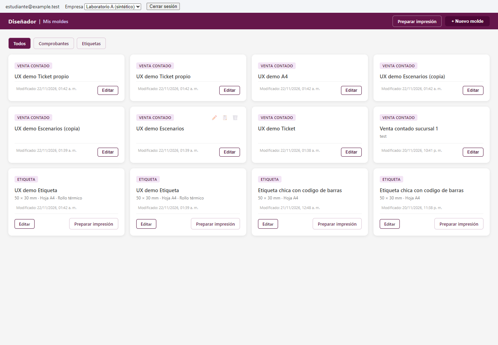
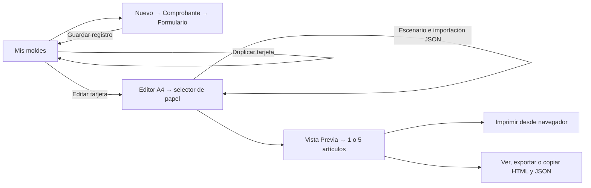
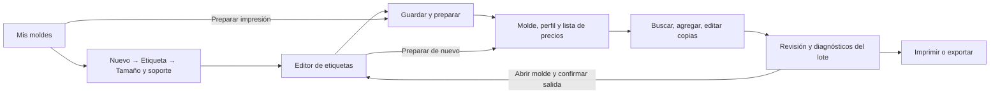
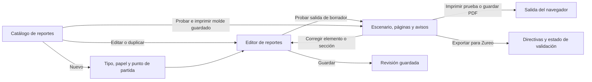
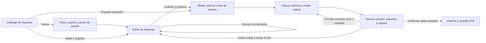

# Rediseño funcional y de experiencia de usuario

**Propuesta para revisión · 22 de noviembre de 2026**

El producto debe permitir que una persona diseñe un molde, lo pruebe con datos representativos y obtenga una salida que pueda revisar antes de imprimir. La unidad de trabajo en **Reportes** es un comprobante que puede crecer con sus artículos. En **Etiquetas** es una pieza de tamaño fijo que se reproduce para distintos artículos, precios y cantidades. Los dos editores serán independientes y compartirán el lenguaje, los componentes de interfaz y las operaciones de edición equivalentes.

## Evidencia y condiciones de la revisión

Se levantó el checkout de revisión (`e093721`) con Angular, API .NET y MySQL de estudio. Los recorridos se hicieron con el rol editor en el Laboratorio A sintético, en Chromium a 1440 × 1000. La vista de comprobantes usa escenarios de ejemplo incluidos en el diseñador. La preparación de etiquetas usa el catálogo de demostración servido por la API. Las capturas muestran los pasos en la interfaz. Las operaciones de escritura se limitaron a moldes identificados con el prefijo «UX demo».

La prueba del botón **Imprimir** registró si la aplicación entregaba el documento a Chromium. Para medir la salida PDF se procesó con Chromium el HTML del documento entregado. El diálogo nativo, el controlador y la salida en papel quedan pendientes. Queda por contrastar también la equivalencia entre los datos y directivas de Zureo y las salidas de la demo.



## Diagnóstico de los siete recorridos

### 1. Crear un comprobante A4

**Observado.** Iniciar sesión abre «Mis moldes». Nuevo molde → Comprobante abre un formulario de nombre, tipo y descripción. **Crear molde** guarda de inmediato y devuelve al catálogo. **Editar** abre un A4 con 46 elementos repartidos entre encabezado, detalle y pie. Para probar un diseño propio vacié esas tres secciones y agregué tres objetos desde el panel de herramientas: un texto, la fecha y el total. El detalle de artículos siguió apareciendo con la sección vacía de objetos. La fecha insertada sin un formato adecuado se vio recortada. Al reabrir el molde se verificaron los tres objetos y el artículo en la vista. Chromium produjo dos páginas A4 con este molde de prueba de un artículo, frente a un contenedor de página en la vista. [Formulario](rediseno-funcional-y-ux/02-nuevo-comprobante.png) · [Lienzo después de quitar los elementos](rediseno-funcional-y-ux/05-reporte-vacio.png) · [Salida del A4 reconstruido](rediseno-funcional-y-ux/06-a4-reconstruido.png)

**Cambio y verificación.** Ofrecer **En blanco** y **Factura A4**, abrir el editor desde la creación y hacer seleccionable la configuración del detalle de artículos. El selector de campos debe mostrar el valor con el formato de fecha antes de insertar. Reusar el ejemplo A4, las secciones y el generador de tablas. El flujo se acepta si un usuario construye un comprobante con título, fecha, detalle y total, obtiene una hoja con un artículo para el caso de referencia y puede localizar la causa de una segunda página cuando la salida realmente la requiere.

### 2. Crear un comprobante térmico

**Observado.** El nuevo comprobante empieza en A4. Elegí «Ticket 80 mm» dentro del editor. El ejemplo convertido mostró textos recortados y un espacio amplio entre el último artículo y los totales. Vacié un segundo molde y agregué un título y un campo total. El render añadió por sí solo «DESCRIPCIÓN», «SUBTOTAL» y la línea del artículo, y mantuvo el campo total colocado al pie. Chromium recibió el documento con vista angosta y, al generar el PDF con su tamaño predeterminado, usó Carta. [Cambio de papel](rediseno-funcional-y-ux/07-ticket-ajuste.png) · [Conversión a ticket](rediseno-funcional-y-ux/08-ticket-previo.png) · [Ticket reconstruido](rediseno-funcional-y-ux/08d-ticket-reconstruido.png)

**Cambio y verificación.** Elegir 80 o 58 mm al crear. Usar un punto de partida térmico con detalle vertical y pie que siga al contenido. Identificar qué bloques se generan y definir el total una sola vez. Mostrar ancho y medio efectivo antes de enviar la salida, incluyendo qué ajuste controla la impresora. Reusar el detalle vertical y los preajustes de papel. Probar un ticket corto y uno largo con descripciones extensas, comprobar el ancho efectivo y el total único, y medir el corte en la impresora objetivo.

### 3. Editar, duplicar y reutilizar un molde

**Observado.** En un molde de prueba, seleccioné un campo, modifiqué su X a 116 mm y guardé. Para duplicar volví al catálogo y usé el icono de la tarjeta. La copia apareció como «(copia)» y quedó en el catálogo, junto al original. Se pudieron generar dos copias con el mismo nombre al repetir la acción. Renombré una copia desde «Editar metadatos», verifiqué que conservaba la posición de 116 mm y la usé con el escenario de cinco artículos. Las tarjetas de comprobantes muestran el tipo y la fecha, y las de etiquetas muestran tamaño y soportes. [Catálogo y copia](rediseno-funcional-y-ux/08c-reporte-copia.png) · [Variante reutilizada](rediseno-funcional-y-ux/18-reporte-copia-reutilizada.png)

**Cambio y verificación.** Hacer explícita la acción **Duplicar** en ambos catálogos, sugerir un nombre distinguible entre variantes y abrir la nueva revisión. Mostrar soporte y formato en cada fila. Reusar duplicado y edición de metadatos. Al guardar cambios en una variante, volver al catálogo y reabrir ambos, se deben reconocer las dos identidades y poder probar la copia con otros datos.

### 4. Previsualizar distintas cantidades de artículos

**Observado.** En Vista Previa pulsé el botón «1 artículo» para pasar a cinco. El cambio reemplazó las líneas por el juego de demostración con «Producto Alpha» y otros artículos. Para 65 líneas volví a Diseño e importé un JSON derivado del ejemplo histórico, con nombres numerados y campos del comprobante de origen. Se verificó la presencia de las 65 descripciones en el HTML del A4, que contenía un contenedor `.page`. El PDF generado por Chromium tenía dos páginas A4. Repetí con descripciones largas en el ticket de 80 mm. El HTML mostró las 65 descripciones y el PDF predeterminado produjo seis páginas Carta. Los datos importados prueban composición y conservan los importes de cabecera de demostración. [Cinco artículos](rediseno-funcional-y-ux/08a-reporte-cinco.png) · [A4 largo](rediseno-funcional-y-ux/08b-reporte-paginacion.png) · [Ticket largo](rediseno-funcional-y-ux/22-ticket-largo.png)

**Cambio y verificación.** Dar acceso a los escenarios desde la misma vista, con nombre y cantidad visibles, páginas navegables y diagnóstico junto al resultado. Reusar los escenarios históricos y CFE, la importación en memoria y el enlace a elementos desde avisos. En una prueba con importes consistentes, rastrear la primera y última línea de cada hoja, los encabezados repetidos y la posición del total en el PDF que se entregará.

### 5. Crear y configurar una etiqueta

**Observado.** La creación guiada permitió elegir **50 × 30 mm** y **Rollo térmico** antes de abrir el editor. El molde partió con logo, nombre, precio y barras. Probé agregar texto por clic, eliminar el elemento añadido y cambiar el código a EAN13. El panel **Datos** ofreció nombres legibles y mantuvo la ruta avanzada plegada. Al desplegar **Configuración de impresión** para ese rollo, la pantalla mostró a la vez filas, columnas, separaciones, guías interiores, márgenes A4, dimensiones y ajustes del rollo. El nombre de artículo de la simulación del editor era distinto al del catálogo demo de impresión. [Creación guiada](rediseno-funcional-y-ux/09-etiqueta-inicio.png) · [Vínculo de texto](rediseno-funcional-y-ux/10-etiqueta-datos.png) · [Configuraciones y código](rediseno-funcional-y-ux/11-etiqueta-configuracion.png)

**Cambio y verificación.** Conservar la creación guiada y los vínculos semánticos. Hacer opcional la pieza inicial, mostrar solo el perfil seleccionado al editar el soporte y mantener calibración al alcance de quien imprime. Reusar preajustes, perfiles y editor de campos de etiquetas. Un diseñador debe poder identificar qué cambia la pieza y qué cambia su distribución, simular nombres largos y ver un error de ancho de rollo en el control que lo produjo.

### 6. Seleccionar artículos, listas y copias

**Observado.** Con el molde preseleccionado elegí Principal, busqué `DEMO-00`, agregué arroz y azúcar y asigné dos copias de arroz y una de azúcar. La vista mostró $65,00, $65,00 y $58,00. Al pasar a Mayorista conservó orden y cantidades y mostró $52,00, $52,00 y $46,00. La búsqueda y la revisión están en partes distintas de la pantalla. Tras «Ir a revisión», la barra inmediata de impresión presenta soporte y páginas, mientras el selector de lista queda arriba. [Estado inicial](rediseno-funcional-y-ux/12-lote-inicio.png) · [Principal](rediseno-funcional-y-ux/13-lote-principal.png) · [Mayorista](rediseno-funcional-y-ux/14-lote-mayorista.png)

**Cambio y verificación.** Mantener el mecanismo actual de resolución y revisión por instantánea. Acercar búsqueda, cantidades y vista previa, y repetir la lista y el total junto a Imprimir. El cambio de lista debe conservar dos referencias y tres etiquetas, invalidar temporalmente la salida y restablecer la impresión solo cuando corresponda a los precios revisados.

### 7. Preparar e imprimir con un molde nuevo y otro guardado

**Observado.** Desde el editor de la etiqueta nueva, **Preparar impresión** abrió el lote con molde y rollo preseleccionados. Con tres copias se invocó la impresión y el PDF de ese documento tuvo tres páginas de aproximadamente 50 × 30 mm. El HTML exportado incluyó las tres etiquetas. Se repitió desde la tarjeta del molde térmico ya guardado y desde un molde de hoja A4 previo al estudio, que produjo las tres etiquetas en una página. Al elegir **Abrir molde** desde un lote y aceptar el aviso genérico «Hay cambios sin guardar», volver a preparar ese molde abrió un lote de cero etiquetas. [Revisión térmica desde catálogo](rediseno-funcional-y-ux/16-lote-desde-catalogo.png) · [Lote vacío después de volver](rediseno-funcional-y-ux/15-lote-vuelta-vacio.png) · [Prueba con molde anterior en hoja](rediseno-funcional-y-ux/19-lote-molde-anterior-a4.png)

**Cambio y verificación.** Mantener la entrada directa desde el molde y la capacidad de imprimir o exportar el documento completo. Conservar el lote al editar el molde y regenerar la vista con la revisión guardada al regresar. En ambos caminos, corregir el diseño y comprobar que sobreviven los artículos, precios revisados y copias. Validar la salida contra las tres posiciones previstas en el rollo o en la hoja.

### Fricciones dentro de los editores

| Aspecto | Reportes | Etiquetas | Decisión de producto |
|---|---|---|---|
| Barra y jerarquía | Diseño, Vista Previa, Perfil fiscal y Análisis fiscal compiten entre sí. En el lienzo, «Comparar impresión» y «Bloques generados» aparecen junto al zoom, papel y ajustes. | La configuración del soporte ocupa una franja completa. El editor y la revisión del lote tienen acciones de salida con distinto alcance. | Dar prioridad a edición y revisión. Llevar configuración de documento a un acceso propio y diagnóstico detallado a revisión. |
| Inserción y organización | La paleta exige arrastrar a una sección. Detalle generado e hitboxes de elementos conviven en la superficie. Los controles de inspección describen resultados del renderer. | Clic o arrastre inserta en la pieza. Para localizar los elementos del ejemplo usé el lienzo. A 300 % se ve bien el área, con controles de ajuste concentrados en la barra. | Incorporar el árbol para ubicar, jerarquizar y recuperar elementos superpuestos. Ofrecer inserción por clic en reportes y conservar el arrastre en ambos. |
| Datos y propiedades | «General / Estilo / Datos» obliga a pasar a Datos para editar texto y a General para ajustar geometría. «Origen de datos» muestra ocho grupos y etiquetas repetidas como «Fecha de emisión», junto a la ruta manual. | Los vínculos de precio y artículo tienen nombres legibles y ruta avanzada opcional. Precio, código y texto presentan controles específicos. | Adoptar la búsqueda por nombre, ámbito y valor de ejemplo. Llevar la ruta al nivel avanzado y conservar los controles específicos en un inspector común. |
| Selección y posición | X e Y en mm, capas con Z-index, bloqueo y selección múltiple dentro de una sección. El tamaño y el estilo del conjunto tienen un inspector propio. | Coordenadas en mm, guías y recorridos cortos de teclado. La selección se concentra en un elemento. El bloqueo está en General. | Unificar selección y movimiento donde las operaciones equivalen. Explicitar el origen de coordenadas y pasar el orden de capas al árbol. |
| Resultado de impresión | La barra reparte Render, HTML, JSON, copiar, exportar, ejemplos e imprimir. El diseñador cambia de tabla a detalle vertical al elegir ticket. | La vista de cada pieza y el lote son experiencias distintas. Hay diagnósticos por artículo y paginación del lote, con mucho espacio vacío alrededor de la pieza térmica. | Dejar en primer plano el resultado, su procedencia, avisos y acción final. Usar zoom de encaje y navegación equivalentes. |

[Campo dinámico de reportes](rediseno-funcional-y-ux/04-reporte-datos.png) · [Selección múltiple](rediseno-funcional-y-ux/17-reporte-seleccion.png) · [Posición en etiquetas](rediseno-funcional-y-ux/20-etiqueta-posicion.png) · [Precio dinámico](rediseno-funcional-y-ux/21-etiqueta-precio.png)

En el mismo gesto de Shift + clic quedaron dos elementos seleccionados en Reportes y uno en Etiquetas. En Etiquetas, la flecha derecha movió la X del precio de 2 a 2,1 mm. La unidad y la precisión ya sirven para el trabajo fino. El alcance de la selección necesita hacerse visible y coherente.

### Prioridad por consecuencia para el usuario

1. **Salida equivocada o difícil de comprobar.** Alinear papel, cantidad, lista y render con la revisión que precede a imprimir. Eliminar la sorpresa de bloques duplicados y dejar claro cuándo un ajuste pertenece al controlador.
2. **Trabajo repetido.** Conservar el lote durante la corrección, abrir directamente un molde nuevo o duplicado y permitir partir de un soporte y base elegidos.
3. **Errores de edición y aprendizaje.** Hacer visibles la estructura, el dato vinculado, su ejemplo y las propiedades relevantes. Dar significado consistente a selección, capas, avisos y guardado.

### Hipótesis a validar con diseñadores

| Hipótesis | Tarea sin asistencia | Evidencia de mejora |
|---|---|---|
| El usuario espera configurar el formato antes de dibujar. | Crear de cero un ticket de 80 mm y un A4. | Selecciona el formato al iniciar, llega al editor correcto y no convierte una factura A4 por necesidad. |
| Los nombres de campos ambiguos dificultan elegir el vínculo adecuado. | Insertar la fecha del comprobante y el precio de lista en sus respectivos editores. | Identifica el valor de ejemplo y explica qué dato se usará al imprimir, sin escribir una ruta. |
| El árbol reduce la búsqueda visual de elementos pequeños o superpuestos. | Seleccionar el código o un campo tapado, moverlo 1 mm y volver al estado anterior. | Selecciona el objetivo correcto, comprende las coordenadas y revierte el ajuste. |
| La pérdida del lote desalienta corregir un molde desde la revisión. | Agregar dos artículos, encontrar un texto recortado, editar el molde y volver a imprimir tres copias. | Completa la corrección sin volver a buscar ni seleccionar artículos. |
| Un resumen de salida evita errores al cambiar de lista o soporte. | Cambiar Principal por Mayorista y revisar un lote de tres piezas para rollo. | Antes de imprimir identifica la lista efectiva, los precios, las copias y el formato. |

### Flujos actuales





## Visión de producto y navegación propuesta

La entrada principal es **Moldes**, con dos destinos visibles en la navegación global. **Reportes** abre su catálogo y **Etiquetas** abre el suyo. Al ingresar por primera vez se abre Reportes, con Etiquetas a un clic. La empresa activa permanece visible. Cada catálogo incluye búsqueda por nombre, filtros por formato y un resumen legible del molde. Conserva sus filtros y posición cuando se vuelve desde un editor. Las acciones de cada fila son **Editar** y **Probar e imprimir** para reportes, **Editar** y **Preparar impresión** para etiquetas. Un menú contiene **Renombrar**, **Duplicar** y **Eliminar**. Abrir un enlace de un molde lleva a su ámbito correspondiente sin perder la referencia al catálogo.

La creación empieza dentro de su catálogo. Reportes pide nombre, tipo, papel y punto de partida. Ofrece **En blanco**, **Factura A4** o **Ticket térmico**, según el soporte. Etiquetas pide nombre, tamaño de la pieza, soporte y punto de partida. Ofrece **En blanco** o un ejemplo de **Nombre, precio y código de barras**. Ambos abren el editor directamente y persisten un molde nuevo al primer guardado explícito. La creación de variantes parte de la revisión guardada y abre la copia ya identificada como tal. El original conserva su versión. Antes de cambiar de empresa o abandonar el editor se ofrecen **Guardar**, **Descartar** y **Seguir editando** si hay cambios pendientes.

### Flujos propuestos





## Especificación de los editores

### Reportes

- **Crear y configurar.** A4 parte de 210 × 297 mm con orientación y márgenes editables. Ticket empieza con 80 o 58 mm, ancho útil y largo determinado por el contenido. Un cambio posterior muestra el impacto en márgenes, anchos y elementos fuera de área antes de aplicarse. La configuración de papel vive en un panel de documento. Un diseño A4 convertido a ticket requiere confirmar una adaptación explícita, con opción de cancelar o guardar una variante.
- **Organizar por sección.** La columna izquierda tiene **Insertar** y **Estructura**. El árbol muestra Encabezado, Detalle y Pie, y distingue los elementos editables de los bloques generados. Seleccionar una fila refleja la selección en lienzo e inspector. Inserción por clic o teclado en la sección activa y arrastre opcional. El control de artículos es un **bloque repetible** seleccionable, con editor de columnas en A4 y de líneas por artículo en térmico. Encabezados de tabla, alto de fila y repetición por página se configuran allí. El pie coloca los totales después del detalle en un ticket. En A4 ofrece un ajuste explícito para ubicar el pie en la última página.
- **Vincular datos.** En **Contenido**, elegir un campo mediante búsqueda por nombre («Fecha», «Total», «Nombre del cliente») y ver su valor de ejemplo. Mostrar el ámbito y los campos que faltan. El detalle ofrece campos del artículo y el documento ofrece campos globales. Formato y valor alternativo se editan junto al vínculo. Las rutas, fórmulas y reglas condicionales quedan bajo opciones avanzadas. La importación JSON migra al menú **Datos de prueba** de la vista previa.
- **Probar y producir.** Mostrar fuente y cantidad de artículos en un selector único, con escenarios de uno, varios y suficientes para varias páginas o un ticket largo. Mantener la selección al volver a diseño. Permitir navegar por páginas y ver en contexto recortes, elementos fuera de papel y fuentes o imágenes pendientes. «Ir al elemento» restaura el foco y selecciona el origen. La vista previa indica si prueba el borrador o la revisión guardada. **Imprimir prueba** lleva a la impresión del navegador y permite guardar PDF cuando el navegador ofrece esa opción. **Exportar para Zureo** conserva las directivas en un menú avanzado con el estado de comprobación correspondiente.
- **Diagnóstico fiscal.** Integrar los avisos que afecten la salida en **Revisión**. Conservar el perfil fiscal en configuración del documento y el detalle del análisis como vista secundaria, con navegación al hallazgo. Indicar cuándo un aviso depende de datos faltantes. Los bloqueos existentes por reglas aplicables requieren causa y acción visible antes de solicitar impresión. La validación en Zureo conserva su propio estado.

### Etiquetas

- **Separar pieza, soporte y dispositivo.** Las dimensiones de la pieza y las guías interiores viven en **Etiqueta**. **Soportes** muestra Hoja A4 y Rollo térmico como perfiles configurables. La hoja muestra orientación, filas, columnas, márgenes y separación. El rollo muestra medidas compatibles, ancho útil y tipo de medio. Los desplazamientos del dispositivo viven en **Calibración**, accesible desde salida. Al revisar un rollo, mantener los ajustes de hoja en su perfil. Si una pieza no cabe, mostrar el ajuste responsable antes de guardar el perfil o producir una salida.
- **Editar una pieza.** **Insertar** ofrece Texto, Precio, Código de barras, Imagen y formas compatibles. **Estructura** lista cada elemento por nombre y permite seleccionar uno oculto detrás de otro, bloquearlo y cambiar el orden. El lienzo muestra una etiqueta a la vez con guías interiores. Selección, movimiento y redimensionado admiten teclado, arrastre y entradas numéricas. El panel de contenido ofrece un ejemplo corto y uno largo. Muestra la procedencia de los datos de precio y código y permite probarlos sin preparar un lote.
- **Preparar un lote.** Abrir con el molde y el soporte heredados y visibles. Seleccionar lista, buscar por nombre, código o barras, agregar con una copia y ajustar cantidades en línea. Mantener lista, búsqueda, selección y cantidades al pasar de revisión a edición del lote, y conservar el lote en la sesión al abrir el editor del mismo molde. Al volver con una revisión nueva, regenerar la vista previa con el molde guardado y advertir el cambio. La búsqueda admite Enter y la acción **Agregar**. La cantidad editada y el total permanecen visibles mientras se agregan artículos.
- **Confirmar la salida.** Mostrar junto a la acción molde, revisión, soporte, dimensiones, lista, hora de consulta, artículos distintos, total de copias y número de páginas. Cambiar de lista mantiene los artículos y cantidades, actualiza precios e invalida la revisión anterior hasta tener una nueva. Un precio ausente bloquea si el molde lo usa. Un precio cero es válido. Mostrar por artículo problemas de precio, código o recorte, con corrección localizada y política explícita de aviso o bloqueo. Imprimir y exportar usan la misma instantánea revisada. Mantener el lote durante reintentos. Al salir del contexto o cambiar de empresa, pedir confirmación si se perderá el lote.

### Propiedades y controles comunes

| Tarea | Comportamiento propuesto |
|---|---|
| Insertar | Controles con nombre y ejemplo visible. Clic inserta en una posición inicial dentro de la zona activa. Arrastrar define posición. Tras insertar, enfocar la propiedad principal del elemento. |
| Seleccionar y localizar | Sincronizar lienzo, árbol e inspector. Shift agrega a la selección. Cuando las secciones de reportes usan orígenes distintos, restringir el movimiento conjunto y explicar el límite. Esc cancela el gesto y luego deselecciona. |
| Posicionar y alinear | X/Y y ancho/alto en mm, origen visible. Flechas mueven 0,1 mm y Shift + flechas mueve 1 mm. Permitir alineación entre elementos y ajuste a una guía. Mostrar el límite físico y el límite imprimible con estilos diferentes. |
| Orden y bloqueos | Menú de elemento con duplicar, bloquear, subir/bajar capa y eliminar. Ocultar el número bruto de Z-index en el inspector principal. Selección múltiple muestra propiedades compatibles y «Valores mixtos». Una operación de conjunto se puede deshacer en un paso. |
| Configurar | Inspector en orden **Contenido → Apariencia → Posición**. Abrir por defecto la propiedad que corresponde al tipo de elemento. Sin selección, mostrar el resumen del documento y acceso a su configuración. |
| Guardar y recuperar | Etiquetas de estado **Cambios sin guardar**, **Guardando**, **Guardado** y **No se pudo guardar**. Mantener selección, scroll y cambios en caso de error. Si existe una revisión nueva del servidor, ofrecer recargar o guardar copia antes de reemplazar el borrador. |
| Diagnósticos | Un resumen con publicación actual, cantidad y nivel. Seleccionar un problema enfoca el elemento o artículo. Avisos corregibles indican la acción. Los bloqueos combinan icono, texto y estado del botón. |

## Wireframes funcionales

Los diagramas representan jerarquía y comportamiento a escala de escritorio. El lienzo y la vista previa reciben el mayor espacio. El inspector y la estructura se pueden colapsar por separado.

```text
MOLDES / REPORTES                                       Empresa activa ▾
Reportes      Etiquetas
Reportes                       [Buscar moldes        ] [Formato ▾] [Nuevo]
Nombre                      Tipo        Formato       Modificado     Acciones
Factura mostrador           Factura     A4            Hoy          [Editar]
                                                                  [Probar e imprimir] [⋯]
Ticket caja                 Venta       80 mm         Ayer         [Editar]
                                                                  [Probar e imprimir] [⋯]

Nuevo reporte
Nombre [                         ]   Tipo [Factura ▾]
Papel  [A4 ▾]                       Inicio [En blanco ▾]
                                           [Cancelar] [Abrir editor]

Nueva etiqueta
Nombre [                         ]   Pieza [50 × 30 mm ▾]
Soporte [Rollo térmico ▾]            Inicio [Nombre, precio y barras ▾]
                                           [Cancelar] [Abrir editor]
```

```text
REPORTES / Factura mostrador                    Cambios sin guardar  [Guardar]
[Diseño | Vista previa] [Papel A4 ▾]       [Deshacer] [Rehacer] [Ajustar ▾] [⋯]
┌─ Insertar | Estructura ─┬───────────────────────────┬─ Propiedades ────────┐
│ Encabezado              │            A4             │ Detalle de artículos │
│   Logo                  │ ┌───────────────────────┐ │ Contenido            │
│   Cliente               │ │ Encabezado            │ │ Columnas [Editar]    │
│ Detalle                 │ │ Detalle seleccionado  │ │ Repetir encabezado   │
│   Detalle de artículos  │ │ Pie                   │ │ Apariencia           │
│ Pie                     │ └───────────────────────┘ │ Posición (mm)        │
│   Total                 │          75%  [−] [+]     │ [Ir a vista previa]  │
└─────────────────────────┴───────────────────────────┴──────────────────────┘
Vista previa   [Datos: ejemplo largo ▾] [Página 1 de 3] [Revisión: 2 avisos ▾]
[Volver a diseño]                                           [Imprimir prueba]
```

```text
ETIQUETAS / Góndola                                    Guardado      [Guardar]
[Diseño | Vista previa] [Etiqueta 50 × 30] [Soportes ▾]   [Preparar impresión]
┌─ Insertar | Estructura ─┬───────────────────────────┬─ Propiedades ────────┐
│ Nombre del artículo     │           50 mm           │ Precio               │
│ Precio                  │   ┌───────────────────┐   │ Contenido            │
│ Código de barras        │   │ Arroz blanco 1 kg │   │ Campo [Precio ▾]      │
│                        │   │ $ 65,00           │   │ Ejemplo $ 65,00       │
│                        │   │ ||||||||||||      │   │ Apariencia           │
│                        │   └───────────────────┘   │ Posición (mm)        │
│                        │ [Ejemplo: nombre largo ▾] │                     │
└────────────────────────┴───────────────────────────┴───────────────────────┘
```

```text
ETIQUETAS / Preparar impresión
Molde [Góndola ▾]  Soporte [Rollo 50 × 30 ▾]  Lista [Mayorista ▾] [Editar molde]
┌─ Buscar y preparar ─────────────────────┬─ Revisar salida ────────────────┐
│ [Buscar artículo o código        ]      │ Página 1 de 3      [‹] [›]      │
│ Artículo            Precio     Copias   │ ┌────────────────────┐         │
│ Arroz blanco 1 kg   $ 52,00    [− 2 +]  │ │ Arroz blanco 1 kg  │         │
│ Azúcar blanca 1 kg  $ 46,00    [− 1 +]  │ │ $ 52,00            │         │
│                                       │ └────────────────────┘         │
│ Consultado 14:32  [Actualizar precios]  │ 2 artículos · 3 etiquetas       │
└────────────────────────────────────────┴──────────────────────────────────┘
Mayorista · Rollo 50 × 30 · 3 etiquetas                         [Imprimir]
```

## Sistema de diseño visual compartido

Los valores propuestos aplican a la interfaz de trabajo. La tipografía y los colores impresos pertenecen a cada molde y se muestran respetando sus unidades de impresión.

| Aspecto | Especificación de la interfaz |
|---|---|
| Tipografía | Inter con reserva de sistema. Texto base 14 px con interlínea 20 px. Etiquetas, 13/18. Títulos de panel, 16/22, peso 600. Títulos de página, 24/32, peso 600. Números de medidas, precios y cantidades con cifras tabulares. IBM Plex Mono solo para rutas, expresiones y datos fuente. |
| Colores | Fondo `#F5F6F8`, superficie `#FFFFFF`, lienzo de trabajo `#E9ECF0`, texto `#17212F`, secundario `#475569`, divisiones `#D5DAE3`. Acción y selección `#6C1D57`, fondo de selección `#F8ECF4`, foco `#1D4ED8`. Éxito `#166534`, aviso `#854D0E`, error `#B91C1C`. Validar contraste de texto y de controles con sus fondos. Estados con texto e icono además de color. |
| Iconografía | Una familia lineal, 16–20 px y grosor uniforme. Icono y texto para acciones poco frecuentes. Atajos como apoyo. Los botones con solo icono tienen nombre accesible y ayuda al enfocar. |
| Espaciado | Paso base de 4 px. 8 entre controles próximos, 12 en grupos de propiedades, 16 de margen interior de panel y 24 entre secciones de página. Controles normales de 36 px y acciones principales de 40 px. Tablas compactas mantienen foco visible y altura suficiente para seleccionar filas. |
| Distribución | Barra global y barra del documento. Lateral inicial de 248 px para insertar y estructura. Inspector inicial de 304 px. Centro flexible con scroll y ajuste a página o ancho. Los laterales se colapsan y recuerdan su estado. A menor ancho, la estructura y el inspector se abren a demanda para que el lienzo siga utilizable. |
| Componentes | Botones, menús, pestañas, inputs con unidad, selector de campo, árbol, barra de estado, avisos contextualizados y diálogos de acciones destructivas. Los estados vacío, ocupado, error y solo lectura mantienen el foco y ofrecen el siguiente paso. |
| Jerarquía | Una acción principal por contexto. **Guardar** en edición, **Imprimir prueba** en vista de reportes e **Imprimir** en la revisión del lote. Exportaciones alternativas y diagnósticos detallados en opciones secundarias. Tab recorre en orden lógico. Toda tarea de edición básica tiene alternativa al arrastre. |

## Decisiones sobre las funcionalidades

| Decisión | Funcionalidad | Justificación y reutilización |
|---|---|---|
| Mantener | Reglas en mm, guías, deshacer, duplicado, vistas previas, diagnóstico accionable e impresión de lote por revisión | Dan control de composición y evitan repetir trabajo. Reusar lienzos, historial, modelos de moldes, renderizadores, componentes de vista previa y la resolución del lote. |
| Replantear | Factura A4 como inicio forzoso y conversión proporcional a ticket | Ofrecer inicios explícitos. Reusar el A4 como ejemplo y la lógica actual de papel y detalle térmico como base del ticket. |
| Replantear | Secciones, elementos y contenido generado de reportes | Exponer el detalle de artículos como bloque editable y distinguirlo del texto que el usuario puede mover. Reusar secciones, geometría, metadatos de render y el enlace desde diagnóstico. |
| Simplificar | Barra de reportes con Grilla, Snap, Elem, comparación y bloques | Agrupar ayudas de composición con lenguaje claro. Conservar comparación y datos de diagnóstico bajo una vista de inspección. |
| Simplificar | Configuraciones de hoja y rollo, guías y calibración simultáneas | Editar el contexto relevante. Reusar perfiles y pantallas de calibración como acceso contextual de salida. |
| Retirar de la tarea principal | Repetición de controles Copiar y Exportar HTML/JSON, Render/HTML/JSON, identificadores internos y valor bruto de Z-index | Un menú avanzado ofrece los formatos de integración vigentes. El árbol y los controles de capa cubren el trabajo de organización. Eliminar accesos duplicados tras comprobar qué exportaciones usa cada perfil. |
| Incorporar | Árbol, inserción accesible, selector de datos centrado en el valor, caso largo listo para usar y conservación del lote al corregir el molde | Hace posible completar y recuperar el trabajo con menos saltos de contexto. Reusar selección, vínculos de datos, escenarios existentes y controlador del lote. |
| Postergar | Reimpresión histórica persistente, cambios masivos de moldes, múltiples dispositivos por puesto y edición colaborativa | La primera presentación necesita un flujo confiable de principio a fin con formatos representativos. El lote activo cubre la corrección y el reintento inmediato. |

## Alcance mínimo y entrega incremental

**Imprescindible para la presentación.** Dos catálogos y editores, creación en blanco o desde ejemplo, recuperación al editar y duplicar, estructura e inspector coherentes con inserción por teclado o clic, posicionamiento preciso, comprobante A4 paginado, ticket de 80 mm con largo adecuado al contenido, etiqueta térmica con precio y barras, preparación con dos listas y edición de cantidades, revisión explícita y salida reproducible. Incluir una etiqueta en hoja A4 como prueba de regresión del perfil existente. El preset de 58 mm se conserva y debe abrir los moldes existentes correctamente. La validación física completa y la integración con Zureo se tratan como condiciones para afirmar aptitud en producción.

**Deseable.** Ajuste más fino de alineación y distribución, duplicado de disposición entre perfiles compatibles, preajustes de etiquetas frecuentes, plantillas iniciales adicionales y colocación de la primera etiqueta en una hoja empezada.

**Postergable.** Biblioteca administrada de estilos y plantillas, historial persistente de lotes, edición colaborativa y gestión centralizada de perfiles de impresoras.

| Incremento | Dependencia | Criterios de aceptación |
|---|---|---|
| 1. Crear y retomar el molde correcto | Sistema visual mínimo y rutas de catálogo | Desde cada catálogo se llega a un molde en blanco o de ejemplo y a su editor sin regresar al catálogo intermedio. Al duplicar, la copia abre identificada y el original conserva sus datos. Los enlaces anteriores siguen abriendo el ámbito correspondiente. |
| 2. Completar y verificar un reporte | 1 y render actual | Se compone un A4 y un ticket sin convertir un diseño preexistente. Se insertan campos por clic o teclado, se ajusta X/Y y se puede deshacer un movimiento. Con 1, 5 y 65 líneas, los importes de prueba corresponden al escenario. En A4 aparecen todas las líneas y encabezados esperados, y el total aparece una sola vez. El ticket no corta descripción ni importe y termina cerca del pie. La salida PDF de prueba se compara con los límites digitales del soporte. |
| 3. Diseñar y producir un lote de etiquetas | 1 y resolución de precios actual. Adopta los controles compartidos validados en 2 | Con el molde nuevo y uno guardado, simular y poder imprimir 2 copias del artículo A y 1 del B. Cambiar lista conserva cantidades y actualiza precios. Editar y volver conserva el lote y regenera la revisión. Detectar precio faltante y ancho incompatible antes de imprimir. Confirmar en el PDF 3 piezas de 50 × 30 mm en rollo y revisar la distribución en hoja A4. |
| 4. Consolidar antes de la presentación | 2 y 3 | Salida, errores, foco y navegación verificados en los siete recorridos, también por teclado para las acciones principales. Un diseñador nuevo puede terminar un caso A4 y uno de etiquetas sin instrucciones verbales y explicar qué datos y formato está imprimiendo. Ejecutar la prueba con al menos tres personas del perfil objetivo y corregir cualquier bloqueo reproducido. Documentar las diferencias entre el navegador y las salidas que queden por validar. |

Los incrementos 2 y 3 se priorizan por el riesgo de salida equivocada y el costo de rehacer moldes o lotes. Antes de dar el producto por consolidado conviene repetir el mismo guion con la compilación candidata, registrar pasos, retrocesos, errores no recuperables y resultado final. Cada salida se guarda con su molde, escenario y soporte. La estabilización técnica mantiene su propia hoja de trabajo.

## Validación pendiente fuera del laboratorio

- **Con datos y usuarios de Zureo.** Contrastar nombres y reglas de campos, identificadores, importes, descuentos, impuestos y casos sin precio. Probar un comprobante A4 de varias páginas y un ticket largo con los mismos datos en el navegador y en la salida con directivas ejecutadas por Zureo. Con usuarios nuevos registrar dónde buscan la siguiente acción y si pueden explicar origen de datos, estado de guardado y revisión usada.
- **Con impresoras.** Medir tamaño y desplazamiento de A4 y rollo, probar 80 mm y un formato real de etiqueta, medir ancho útil y margen, revisar escala, cortes y saltos. Leer el código de barras en varias piezas y repetir una tirada para comprobar estabilidad. Registrar modelo, controlador, medio y ajustes del diálogo. Una revisión digital aprobada sirve para presentar el producto con datos sintéticos. La aprobación física y con Zureo sustenta su uso operativo.
